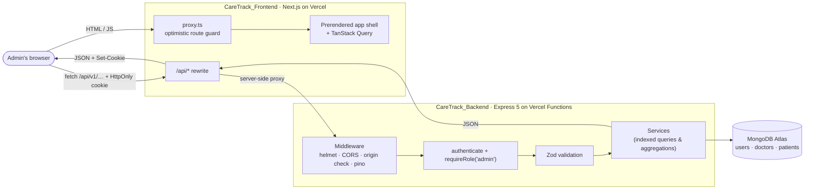
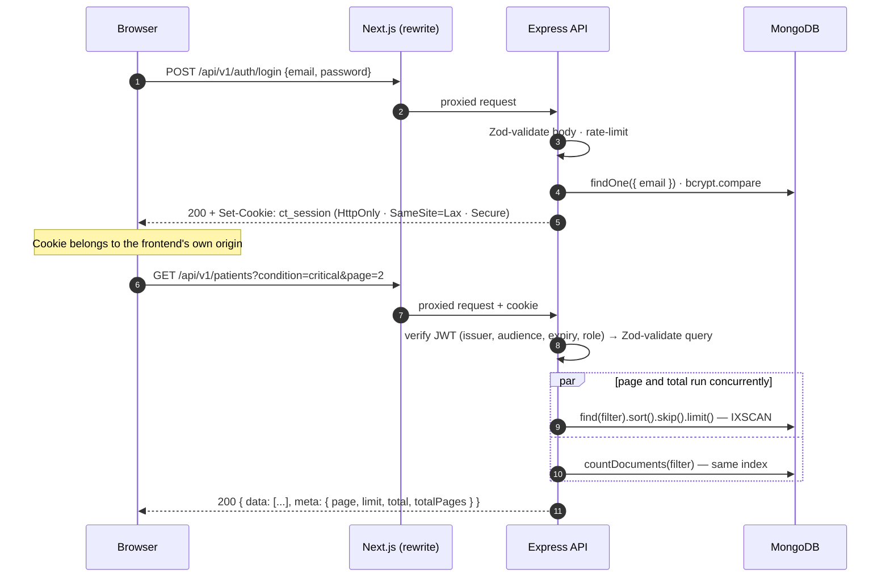
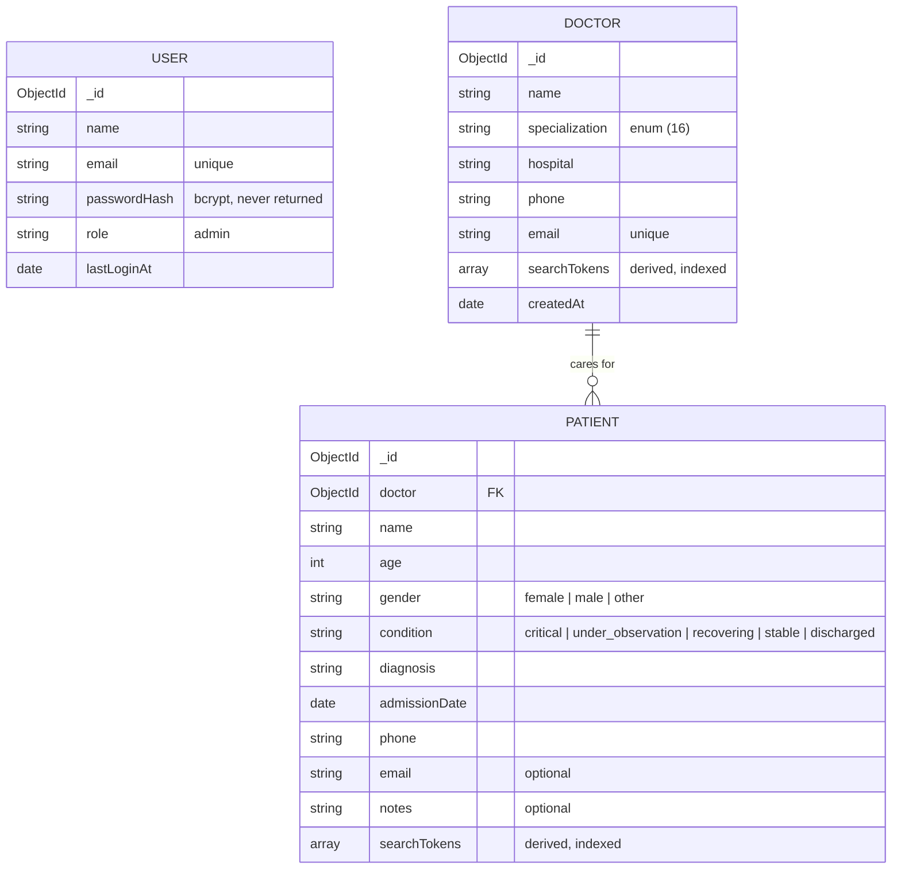
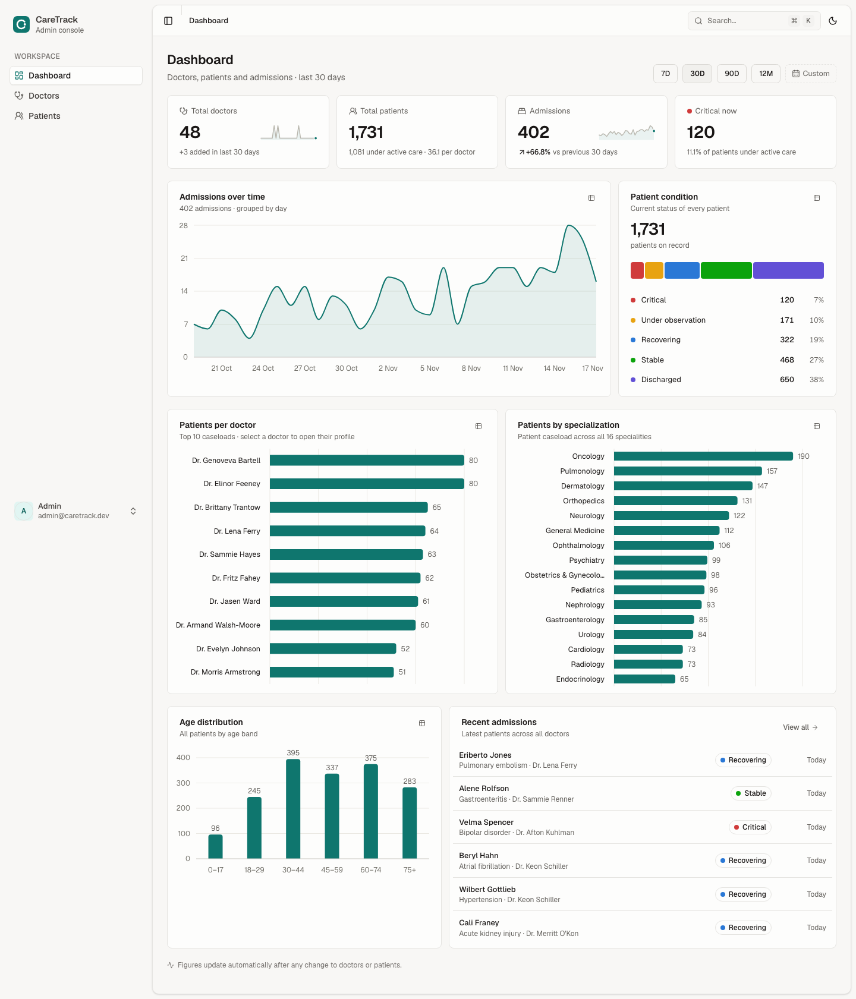
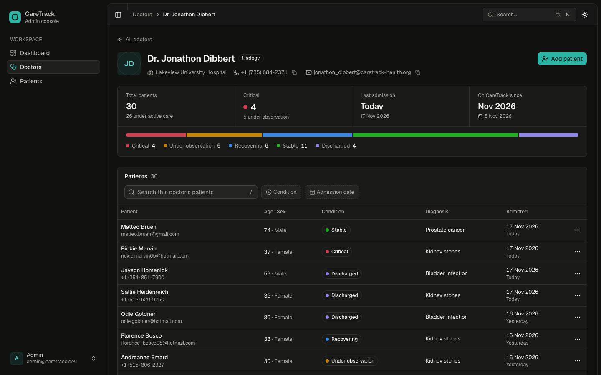
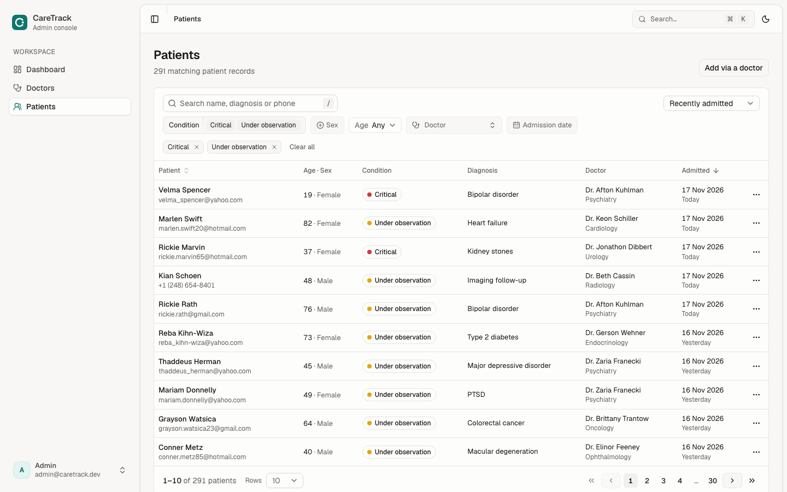
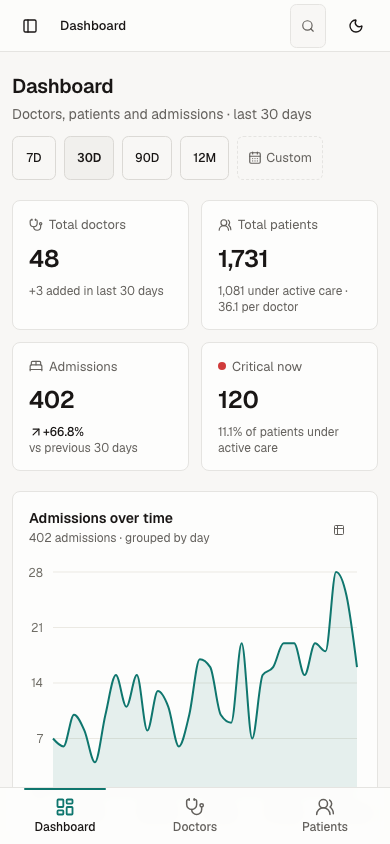
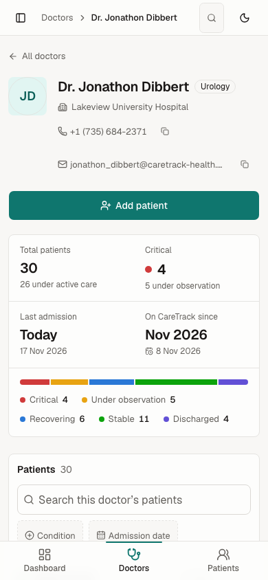
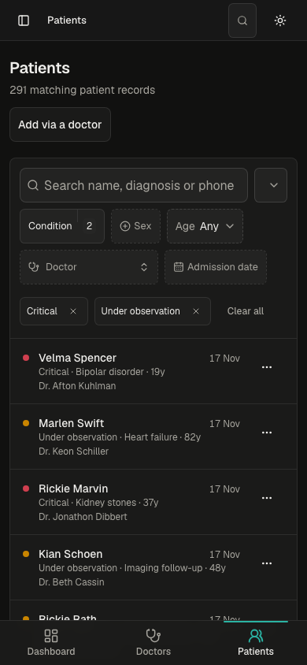
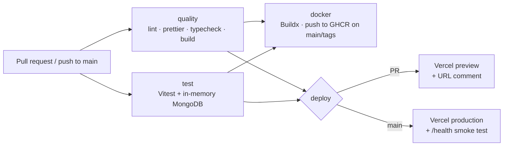

# CareTrack — Backend API

Standalone REST API for **CareTrack (Doctor Tracker)**, built with Node.js 24, Express 5, TypeScript and MongoDB (Mongoose 9).

| | |
|---|---|
| **Backend repo** (this) | https://github.com/NoManNayeem/CareTrack_Backend |
| **Frontend repo** | https://github.com/NoManNayeem/CareTrack_Frontend |
| **Live app** | _added after deployment_ |
| **Live API health** | _added after deployment_ (`/api/v1/health`) |
| **Demo credentials** | `admin@caretrack.dev` / `CareTrack@2026` |

### Project walkthrough video

<!-- Replace VIDEO_URL with the link to the walkthrough video (YouTube, Loom, Google Drive…). -->
<a href="VIDEO_URL">
  
</a>

▶ **[Watch the walkthrough (~5 min)](VIDEO_URL)**: a product tour of CareTrack, what it does and how the frontend and backend work together.

---

## Description

CareTrack is a secure administrative web application for managing doctors and the patients under their care. Signed-in administrators can:
- register doctors and browse them with search, filters and pagination,
- add patients under a specific doctor, edit them, reassign them or remove them,
- read a dashboard of totals, patients per doctor, condition mix and admission trends.

This repository is the **standalone REST API** behind the Next.js client. It handles authentication with a JWT in an HTTP-only cookie, validates every request with Zod, and runs every MongoDB query. Each list, filter and search is backed by a compound index (checked in CI), so it stays fast as the data grows.

---

## Setup Guide

### Prerequisites

| Tool | Version | Needed for |
|---|---|---|
| Git | any | cloning |
| Docker Desktop | 4.x (Compose v2) | **Option A** (recommended) |
| Node.js + npm | **24.x** (see `.nvmrc`) + npm 11 | Option B and running tests |
| MongoDB | 7.x | Option B only (or use the Docker one-liner below) |

### Option A — Docker (recommended)

```bash
# 1. Clone
git clone https://github.com/NoManNayeem/CareTrack_Backend.git
cd CareTrack_Backend

# 2. Start MongoDB 7 + the API (builds the image; waits until both are healthy)
docker compose up -d --build --wait

# 3. Load demo data: 1 admin, 48 doctors, ~1,700 patients across 18 months
docker compose --profile seed run --rm seed

# 4. Verify
curl http://localhost:4000/api/v1/health
# → {"status":"ok","db":"up","uptime":3}
```

- The API is now on **http://localhost:4000** and MongoDB on `localhost:27017` (database `caretrack`).
- The compose file creates a Docker network named **`caretrack-net`**. The frontend's compose file joins it, so start this one first.
- Docker needs no `.env` file. Development defaults are built into `docker-compose.yml`. To override them, export variables before `docker compose up`, for example `JWT_SECRET=$(openssl rand -base64 48) docker compose up -d`.

**Useful commands:**

```bash
docker compose logs -f api                      # follow API logs
docker compose --profile seed run --rm seed     # reset demo data at any time
docker compose down                             # stop (keeps data)
docker compose down -v                          # stop and delete the database volume
```

### Option B — Run with Node.js

```bash
git clone https://github.com/NoManNayeem/CareTrack_Backend.git
cd CareTrack_Backend

# 1. MongoDB: use a local install, Atlas, or this one-liner
docker run -d --name caretrack-mongo -p 27017:27017 mongo:7.0

# 2. Environment
cp .env.example .env
#    then edit .env and set JWT_SECRET, e.g.:  openssl rand -base64 48

# 3. Install, seed, run
npm ci
npm run seed        # optional demo data
npm run dev         # http://localhost:4000 with hot reload
```

To run the production build locally: `npm run build && npm start`.

### Environment variables (`.env.example`)

```dotenv
NODE_ENV=development
PORT=4000
LOG_LEVEL=info
MONGODB_URI=mongodb://localhost:27017/caretrack
JWT_SECRET=replace-with-a-long-random-string-at-least-32-chars
JWT_EXPIRES_IN=8h
COOKIE_NAME=ct_session
FRONTEND_URL=http://localhost:3000
SEED_ADMIN_NAME=Admin
SEED_ADMIN_EMAIL=admin@caretrack.dev
SEED_ADMIN_PASSWORD=CareTrack@2026
# COOKIE_SECURE=false   # only for NODE_ENV=production over plain http
```

| Variable | Required | Purpose |
|---|---|---|
| `MONGODB_URI` | ✓ | MongoDB connection string (`mongodb+srv://…` for Atlas) |
| `JWT_SECRET` | ✓ | At least 32 characters. Signs session tokens with HS256. The API refuses to start without it. |
| `JWT_EXPIRES_IN` | | Session lifetime (`8h` by default) |
| `FRONTEND_URL` | | Comma-separated browser origins allowed by CORS and the CSRF origin check |
| `COOKIE_NAME` / `COOKIE_SECURE` | | Session cookie name / force the `Secure` flag (on by default in production) |
| `SEED_ADMIN_*` | | Admin account created by `npm run seed` |

The environment is validated with Zod when the API starts, and a missing or weak value stops it with a clear message. Real `.env` files are ignored by Git; only `.env.example` is committed.

### Run the checks

```bash
npm test            # 43 tests · Vitest + Supertest against an in-memory MongoDB
npm run lint        # ESLint (typescript-eslint)
npm run typecheck   # TypeScript 7, including tests and scripts
npx prettier --check .
```

The first `npm test` downloads a MongoDB binary for `mongodb-memory-server`, about 100 MB, and caches it.

### Troubleshooting

| Symptom | Fix |
|---|---|
| `port is already allocated` (4000 / 27017) | Stop whatever uses the port, or change the published port in `docker-compose.yml` |
| Mongo container restarts with *"Linux kernel versions 6.19.0 through 7.0.13…"* | That's MongoDB **8.x** ([SERVER-121912](https://jira.mongodb.org/browse/SERVER-121912)). This repo pins `mongo:7.0` for that reason; don't change it to 8 for local Docker |
| `Invalid environment configuration` on start | A variable in `.env` is missing or invalid; the message names it |
| Browser login works but data requests return `401` | The frontend must reach the API through its own `/api` rewrite. Check that `API_URL` points here and `FRONTEND_URL` matches the frontend origin |

---

## System Architecture

### Service interactions



### Request lifecycle: sign-in, then an authenticated list request



### Data model



### Code structure

Every module follows the same layers: **routes → `validated(zod)` → controller (thin) → service (queries) → model**.

```
src/
├── app.ts               Express app; default export = Vercel entry point
├── server.ts            app.listen + graceful shutdown (Docker / local)
├── config/env.ts        Zod-validated environment
├── db/connect.ts        serverless-safe, cached Mongoose connection
├── lib/                 http-error · jwt (jose) · pagination · search tokens · shared schemas · logger
├── middleware/          authenticate · require-role · validate · origin-check · rate-limit · ensure-db · error-handler
└── modules/
    ├── auth/            login · logout · me · User model
    ├── doctors/         model + indexes · schemas · service · controller · routes
    ├── patients/        model + indexes · schemas · service · controller · routes
    └── analytics/       dashboard aggregations · time buckets
scripts/seed.ts          reproducible demo data (faker, fixed seed)
tests/                   auth · doctors · patients · analytics · indexes (query-plan guards)
```

### REST API (`/api/v1`)

Every route except `/health` and `/auth/login` needs an **admin session**, sent as the cookie or as `Authorization: Bearer <token>`.

- **Success:** `{ data, meta? }`
- **Error:** `{ error: { code, message, details? } }`. `details` is a list of `{ location, field, message }`, so the client can show each error next to its form field.

| Method | Path | Purpose |
|---|---|---|
| `POST` | `/auth/login` | Check credentials and set the `ct_session` cookie (HttpOnly, SameSite=Lax, Secure in production, 8 h) |
| `POST` | `/auth/logout` | Clear the cookie |
| `GET` | `/auth/me` | Current admin |
| `GET` | `/doctors` | Search, filter and page. Query: `q`, `specialization[]`, `hospital[]`, `from`, `to`, `sort`, `page`, `limit` |
| `POST` | `/doctors` | Create a doctor (name, specialization, hospital, phone, email). Returns `409` if the email is taken |
| `GET` | `/doctors/facets` | Distinct hospitals and specializations, for filter dropdowns |
| `GET` | `/doctors/:id` | Profile plus caseload stats: count by condition, last admission |
| `GET` | `/doctors/:id/patients` | That doctor's patients. Query: `q`, `condition[]`, `from`, `to`, `sort`, `page` |
| `POST` | `/doctors/:id/patients` | Add a patient under this doctor |
| `DELETE` | `/doctors/:id/patients/:patientId` | Remove a patient, **only if** they belong to this doctor |
| `GET` | `/patients` | Search, filter and page. Query: `q`, `condition[]`, `gender[]`, `doctor`, `minAge`, `maxAge`, `from`, `to`, `sort`, `page`, `limit` |
| `GET` · `PATCH` · `DELETE` | `/patients/:id` | Read · partial update (can reassign the doctor) · delete |
| `GET` | `/analytics/overview` | Dashboard metrics for `from`–`to`, grouped by day, week or month automatically |
| `GET` | `/health` | Liveness check plus a database ping |

**Status codes:**
- `200`, `201` (with a `Location` header), `204`
- `400` validation error, with field details
- `401` not signed in · `403` wrong role, or a write from a foreign origin
- `404` · `409` duplicate · `413` body too large · `429` too many login attempts
- `503` database unavailable

### Security

| Concern | Measure |
|---|---|
| Passwords | bcrypt with cost 12. When the email is unknown, the API still runs one bcrypt comparison, so response time doesn't reveal which accounts exist |
| Sessions | HS256 JWT signed with `jose`. Issuer, audience, expiry and `role` are all checked. Stored in an **HttpOnly** cookie that page scripts can't read |
| CSRF | `SameSite=Lax` cookie, plus an `Origin` allow-list check on every request that changes data |
| Input | Strict Zod schemas (unknown fields are rejected), 100 kb body limit, user input escaped before it's used in a regex |
| Headers & logging | `helmet` security headers; pino logs redact `cookie`, `authorization` and `set-cookie` |
| Brute force | `express-rate-limit` on `/auth/login` (10 failed attempts per 15 minutes) |
| Authorization | Checked on the server for every resource route. Patient deletion under a doctor checks the patient belongs to that doctor |

---

## Technical Decisions

### 1. Same-origin proxy + HTTP-only JWT cookie across two separately deployed services

**Context.**
- The spec requires a separate Next.js client and a standalone Express server, so they deploy to two different `*.vercel.app` hosts.
- `vercel.app` is on the Public Suffix List, which makes those two hosts different **sites**.
- A cookie set by the API would therefore be a **third-party cookie**. Safari blocks those and Chrome increasingly restricts them.

**Options considered.**

| | Same-origin rewrite **(chosen)** | Cross-site cookie + CORS | Token in `localStorage` |
|---|---|---|---|
| Works with third-party-cookie blocking | ✅ | ❌ (Safari ITP) | ✅ |
| Readable by injected JS (XSS) | ❌ HttpOnly | ❌ HttpOnly | ⚠️ **exposed** |
| CSRF exposure | Low (Lax + Origin check) | Higher (needs `SameSite=None`) | None, but XSS means full takeover |
| CORS preflight per request | None | Yes | Yes |
| Frontend can guard routes before render | ✅ (`proxy.ts` sees the cookie) | ❌ | ❌ |

**Decision.**
- The browser never calls the API host directly.
- The Next.js app rewrites `/api/:path*` to `${API_URL}/api/:path*`.
- The API sets its cookie without a `Domain` attribute, so the browser treats it as belonging to the frontend's own origin.

**Consequences.**
- The API stays standalone and RESTful. CORS for configured origins and Bearer tokens still work for Postman, curl and other services.
- The frontend's `proxy.ts` can redirect signed-out users *before* any page renders. It only checks that the cookie exists and hasn't expired, and the frontend holds **no signing secret**. The API is the real authority on every request.
- **Trade-off:** each request makes one extra hop through Vercel's network. Both projects run on that same network, so the added latency is small.

### 2. ESR compound indexes + token-prefix search, not `$regex /i` or `$text`

**Context.** The evaluation weighs query optimization for search, filtering and pagination. The common shortcuts don't scale:
- `{ name: /term/i }` can't use a B-tree efficiently, so it scans every document.
- `$text` matches whole words only, so typing *"rami"* never finds *Ramírez*.
- Sorting a filtered set in memory (a blocking `SORT` stage) gets slower with every page and is capped at 100 MB.

**Decision.**
- **One compound index per list view, ordered Equality → Sort → Range (ESR).** MongoDB then filters *and* sorts straight from the index:

  | Collection | Index | Serves |
  |---|---|---|
  | patients | `{ doctor: 1, admissionDate: -1 }` | a doctor's patients, newest first; patients per doctor |
  | patients | `{ condition: 1, admissionDate: -1 }` | condition filter + date range; per-condition counts (`COUNT_SCAN`) |
  | patients | `{ gender: 1, admissionDate: -1 }` | sex filter |
  | patients | `{ admissionDate: -1, _id: -1 }` | default list, date filters, dashboard timeline |
  | doctors | `{ specialization: 1, createdAt: -1 }` · `{ hospital: 1, createdAt: -1 }` · `{ createdAt: -1, _id: -1 }` | doctor filters + date-added range; distinct hospitals |
  | both | `{ nameNormalized: 1, _id: 1 }` | A→Z / Z→A sort |
  | both | `{ searchTokens: 1 }` (multikey) | search |
  | doctors | `{ email: 1 }` unique | duplicate detection → `409` |

- **Search uses token prefixes.**
  - On each save, a hook stores `searchTokens`: every name word (and, for patients, the diagnosis) in lowercase without accents, the full email, and the phone digits.
  - A query like *"sofia ram"* becomes `{ searchTokens: { $all: [/^sofia/, /^ram/] } }`.
  - Anchored regexes on normalised data become bounded index ranges.
  - Input is regex-escaped, and a query made only of symbols matches nothing.
- **Pagination** runs `find().skip().limit()` and `countDocuments()` **at the same time**, both on the same index, with `.lean()` and a field projection. Page size is capped at 100.
- **Patient counts in the doctor list** come from a `$lookup … $count` for the 10–20 doctors on the current page only. There's no stored counter that could drift out of sync.
- **The dashboard avoids one giant `$facet`**, because `$facet` sub-pipelines can't use indexes. The overview instead runs about 11 small queries **concurrently**:
  - `estimatedDocumentCount` (reads collection metadata)
  - per-condition `COUNT_SCAN`s
  - a timeline from an index range plus `$dateTrunc`
  - top doctors found by walking the `{ doctor: 1 }` index

  Total latency is roughly that of the slowest single query.

**Evidence.** `explain("executionStats")` on the seeded data (1,731 patients). `tests/indexes.test.ts` asserts the same plans on every CI run: `IXSCAN`, never `COLLSCAN`, and no blocking `SORT`.

```
Patients: condition=critical, newest 10   LIMIT ← FETCH ← IXSCAN(condition_1_admissionDate_-1)     returned 10 · keys 10 · docs 10
Patients: one doctor, newest 10           LIMIT ← FETCH ← IXSCAN(doctor_1_admissionDate_-1)        returned 10 · keys 10 · docs 10
Patients: admitted in Oct 2026, page 3    LIMIT ← FETCH ← SKIP ← IXSCAN(admissionDate_-1__id_-1)  returned 10 · keys 30 · docs 10
Patients: search "diab"                   LIMIT ← FETCH ← IXSCAN(searchTokens_1)                   returned 10 · keys 10 · docs 10
Doctors: Cardiology, newest               LIMIT ← FETCH ← IXSCAN(specialization_1_createdAt_-1)    returned  3 · keys  3 · docs  3
— contrast, no index — diagnosis /diab/i  LIMIT ← COLLSCAN                                         returned 10 · keys  0 · docs 128
```

Every indexed query examines exactly as many keys as documents it returns, which is the best possible ratio. The unindexed regex reads 128 documents to find 10, and that number grows with the collection.

**Trade-offs.**
- Search matches the *start* of each word, not the middle. That fits name lookups and keeps the index bounded. Fuzzy or infix matching would mean Atlas Search, the natural next step.
- Page-number pagination uses `skip`, which costs O(offset). That's acceptable at admin page sizes. The `{ admissionDate, _id }` index already supports keyset pagination if deep paging is ever needed.

---

## Visual Evidence

The API powers every screen below; the frontend README has the full set. Images are generated by Playwright from the seeded Docker stack.

### Desktop

| Dashboard | Doctor profile & patients |
|---|---|
|  |  |



### Mobile

| Dashboard | Doctor profile | Patients |
|---|---|---|
|  |  |  |

### Test evidence

```
$ npm test
 ✓ tests/auth.test.ts        (8)   401s, cookie flags, tampered tokens, Bearer tokens, CSRF origin block
 ✓ tests/doctors.test.ts     (14)  validation, 409, pagination meta, search, filters, ownership checks
 ✓ tests/patients.test.ts    (7)   filters, sorting, search, PATCH + reassignment, delete
 ✓ tests/analytics.test.ts   (6)   aggregation shape, zero-filled buckets, range validation
 ✓ tests/indexes.test.ts     (8)   query plans: IXSCAN, no COLLSCAN, no blocking SORT
 Test Files  5 passed (5) · Tests  43 passed (43)
```

---

## Appendix

### Docker

- **`Dockerfile`** is a multi-stage build:
  - `deps` → `build` (TypeScript 7 `tsc`) → `prod-deps`
  - a small **`runtime`** stage: `node:24-alpine`, runs as the non-root `node` user, uses `tini`, and has a `HEALTHCHECK`
  - a separate **`tools`** stage that runs the seed script
- **`docker-compose.yml`** runs MongoDB 7 (health check, named volume), the API (starts only after Mongo is healthy), and the `seed` job behind a profile.
- **`.dockerignore`** keeps `.env*`, `node_modules`, tests and Git metadata out of the build context, so no secret can end up in an image.

### CI/CD (`.github/workflows/ci-cd.yml`)



- Deploys run **only** when quality and tests pass. `vercel.json` sets `git.deploymentEnabled: false`, so Vercel never builds code that skipped CI.
- Images are published as `ghcr.io/nomannayeem/caretrack_backend:{sha,latest,semver}`.
- **No secrets in the repository.**
  - Vercel credentials come from GitHub Actions secrets, are read only in the deploy job, and are masked in logs.
  - Runtime secrets (`MONGODB_URI`, `JWT_SECRET`) live only in Vercel's environment settings.
  - When the secrets aren't set (for example on forks), the deploy job skips cleanly.
- Dependabot updates npm packages, GitHub Actions and the Docker base image every week.

### Deploying (free tier)

1. **MongoDB Atlas M0:**
   - Create a cluster and a database user.
   - Under **Network Access**, allow `0.0.0.0/0`, because Vercel functions use changing IPs.
   - Copy the `mongodb+srv://` URI.
2. **Vercel:** import this repo. The Express preset is detected automatically from `src/app.ts`. Set these environment variables:
   - `MONGODB_URI`
   - `JWT_SECRET` (generate with `openssl rand -base64 48`)
   - `FRONTEND_URL=https://<frontend>.vercel.app`
   - `NODE_ENV=production`
3. **GitHub → Settings → Secrets and variables → Actions:** add `VERCEL_TOKEN`, plus `VERCEL_ORG_ID` and `VERCEL_PROJECT_ID` from `.vercel/project.json` after running `vercel link`.
4. **Seed production once** from your machine: `MONGODB_URI="<atlas-uri>" npm run seed`.

### Scalability notes

- The Mongoose connection is cached on `globalThis` (`maxPoolSize: 10`), so warm serverless instances reuse their pool.
- Sessions are stateless JWTs, so any instance can serve any request. To revoke sessions, add a `tokenVersion` field to the user.
- The login rate limiter counts per instance. For a strict global limit, back it with Redis (for example Upstash).
- Next steps as data grows: Atlas Search for fuzzy matching, and keyset pagination for very deep pages.
